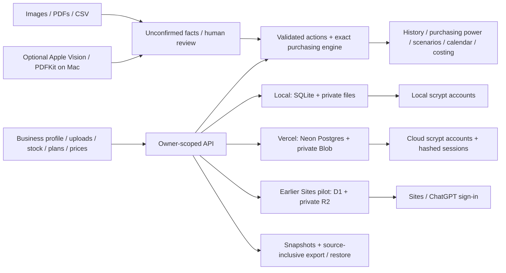

# beply v1.3 — architecture

## Runtime choices

The public Vercel application at https://beply.vercel.app runs the root Next.js application with Neon Postgres, private Vercel Blob, and its own owner accounts. `VERCEL=1` dispatches API requests to `src/server/cloud/` before local filesystem access. `db/vercel.sql` is an additive build-time migration; its statement parser is tested against Postgres. See VERCEL.md for the cloud security and recovery design.

The local application uses Next.js 16, React 19, TypeScript, Zod, Recharts, Tailwind and Node 24 SQLite. The hosted application is a separate Sites/Vinext checkout in `hosted/beply/`, running on a Cloudflare Worker with D1 records and R2 private source files. Both retain the same domain calculation and transition modules. Hosted UI differences explain platform identity and the disconnected external reading provider.

## Records and ownership

`State` is the business aggregate: location/type, settings, catalog, recipe versions, active/queued/history production, lots, suppliers/offers, price observations/basket, inventory/expense/finished events, orders, documents, audit and idempotency keys. Owner workspaces use current server time; sample/guided workspaces use the fixture clock.

Local collection tables are partitioned by workspace. A `BEGIN IMMEDIATE` transaction replaces collection rows and metadata atomically, with optimistic revision checks. Accounts own the original session principal; account sessions contain hashed random tokens and expire server-side. Claiming a guest workspace invalidates its old guest token. Passwords use salted scrypt (N=32768, r=8, p=1, 64-byte output); comparisons are constant-time. Five invalid sign-ins in a 15-minute window throttle that username. Local account recovery/email/MFA are not connected.

Hosted requests require the platform-provided stable user ID and email. The Site remains owner-private. D1 `profiles` binds that ID to an active workspace; every read or activation checks `owner_id`. A workspace's JSON aggregate, revision and identifying metadata are updated in one conditional SQL statement. `WHERE owner_id=? AND revision=?` ensures concurrent stale writes cannot overwrite a newer state. Initial profile/workspace creation uses a D1 batch. Schema creation lives in an inspected Drizzle migration, never a request handler. No local password or guest-token stack is exposed on the hosted build.

Private originals are stored outside public assets locally, and under owner/workspace-scoped R2 keys when hosted. Document access resolves the ID through the active owner's workspace before reading its key. Source responses are no-store, nosniff and sandboxed. Unknown SVG uploads are rejected. Public files contain only product assets, templates and labelled sample documents. Uploaded bytes are hashed and duplicates reuse the source record.

## Calculation model

Mass and volume use whole grams/milliliters; counted items use whole units. Package conversion supports metric and US measures and rejects mass/volume mismatches. Purchasing cash uses integer cents. Recipes round production up to whole batches. Demand comes from the active cycle only; queued services do not reserve stock or cash.

The exact bounded package search considers combinations across eligible suppliers, including mixed packs, minimum spends, per-pack owner-entered tax, trip estimates, shipping, capacity, availability, specification, quote validity and prep deadlines. Supplier masks and capped minimum spends preserve the state needed by dynamic programming. Limits are 300,000 enumeration operations and 40,000 retained states; oversized problems fail explicitly. The result is the minimum calculated cost among represented eligible offers, not the cheapest price in the market.

Sample/local source modes remain separate. Local suppliers belong to the entered city/state/five-digit ZIP. Location changes preserve timestamps and records, invalidate unexecuted approvals and exclude old-location quotes. Daily supplier windows respect supplier timezone, including overnight windows; the planner does not infer holidays or search all future opening days. DST gaps fail validation; repeated hours have explicit first/second choices.

Lots label existing stock and never create quantity. Allocation cannot exceed physical stock without a lot label. Expired-at-prep lot quantities increase purchasing shortfalls while remaining on the physical ledger. Production consumes eligible dated lots in earliest-use-by order, then unlabelled stock. Waste consumes earliest lots first, including expired ones. New counts reconcile the physical balance and clear that item's lot allocation. The older whole-item expiry rule remains available as a conservative stock rule.

## Ledger invariants

| Action | Physical stock | Cash / other state |
|---|---|---|
| Upload / read text | No change | Unconfirmed evidence |
| Confirm recipe | No change | New version |
| Save queued prep | No change | No reservation/commitment |
| Activate production | No consumption | Current requirement/reservation |
| Approve purchase | No change | Unpaid commitment |
| Simulate online order | No change | Local SIM reference only |
| Record payment | No change | Expense once |
| Receive goods | Cumulative received delta once | Partial/received status |
| Complete production | Consume recipe quantities once | Finished goods created |
| Sell finished goods | Ingredients unchanged | Finished stock decreases; no inferred revenue |
| Count | Reconciliation difference | Clears item lot allocation |
| Waste | Explicit negative event | No duplicated cash expense |
| Label a lot | No change | Date/quantity allocation only |

Stable operation keys, purchase references and receipt cumulative totals prevent duplicate events. Statement matching never creates stock. Later receipt evidence can complete a matching invoice; conflicting quantities/suppliers are rejected. Changes to executed outstanding orders require receiving/reconciliation before replacement purchasing. Approved orders retain the calculation/input snapshot. Restored unexecuted approvals are cancelled for review.

## Economic tools

Current package benchmarks, dated source-specific observations, recipes and the same ledger feed all six capabilities. The first confirmed owner production creates a fixed quantity basket; later production does not rebase it. Purchasing power compares cash with the current cost of that fixed basket. Missing benchmark inputs are labelled partial.

Outlooks require seven comparable historical observations and show a flat trailing mean with an explicitly illustrative ±10% range. They are not calibrated predictions or purchasing constraints. Scenarios clone the aggregate and adjust a selected item's prices and production assumptions; they never mutate saved records. Opportunity costs keep owner time separate from purchasing cash. Menu suggestions calculate entered ingredient/labor/packaging/energy/overhead assumptions and flag missing costs.

## Reading, import and recovery

Sample extraction is SHA-256 matched to exact bundled content. Ordinary uploads remain unconfirmed. The optional Mac helper uses Apple Vision and PDFKit with a 60-second timeout, one concurrent read, bounded output and up to 10 PDF pages. It returns recognized text; structured quantities and prices still require owner review/entry. There is no remote provider key or external reading call. Hosted uploads explicitly retain manual review until a provider is connected.

CSV recipes, purchases, production and supplier quotes are previewed row by row, then committed through the same validated actions. Unknown matches/units, conflicting groups and invalid quote provenance fail the import. Repeated content hashes are idempotent.

Local automatic snapshots are atomic JSON files containing source bytes. Hosted snapshots store the state alongside retained immutable R2 sources. Both expose a last-success/error status and retain five snapshots. Downloaded portable archives contain versioned state and base64 source bytes with a checksum. Restore validates schema, identifiers, source hashes, foreign references and nonnegative stock/lot invariants; it creates a new owner-scoped workspace and preserves the original. This is recovery support, not a claim of independently audited disaster recovery.

## Important operating limits

The aggregate rewrite model is bounded for a private pilot. There are no team roles, simultaneous production reservations, full supplier-lot traceability, automatic revenue posting, real ordering/payments, POS/bank feeds or connected external AI. Local automatic snapshots share the machine's failure domain. The hosted memory budget requires bounded record/archive sizes; limits are visible in README and upload errors. A future broader commercial release needs capacity planning, access/security review, retention/deletion workflows, operational monitoring, tested disaster recovery and real integration credentials.

Technical references consulted: [Node crypto](https://nodejs.org/api/crypto.html), [Apple Vision text recognition](https://developer.apple.com/documentation/Vision/VNRecognizeTextRequest), and the installed Sites storage/identity/runtime documentation. Local framework guides were read before changing route/cookie behavior.
